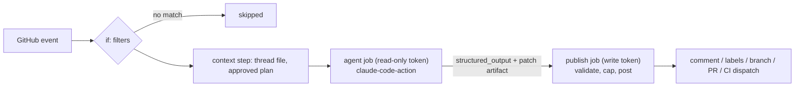
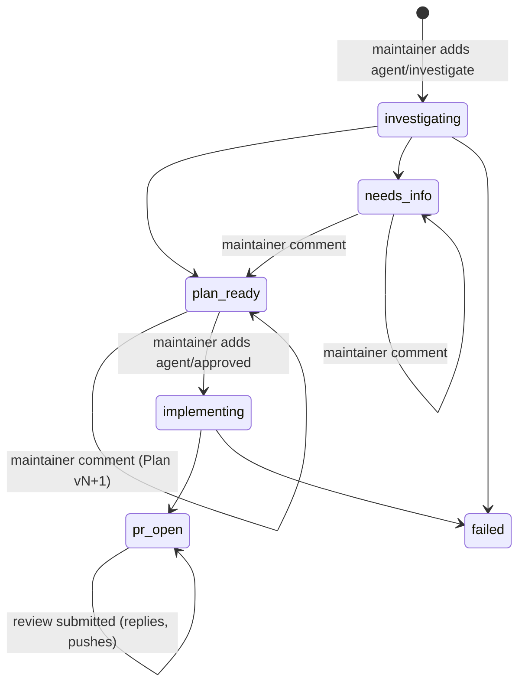

# Proposal: Bug Fixer Agent

_Owners_: @TharmiganK  
_Reviewers_: @TharmiganK  
_Created_: 2026/11/01  
_Updated_: 2026/11/01  
_Status_: Implemented for PoC

## Summary

A GitHub Actions based AI agent that investigates bug reports, reproduces them as Ballerina tests, traces the root cause from the public API down to the native layer, proposes a fix plan, discusses it with maintainers, and, once a maintainer approves the plan, implements the fix and opens a PR with the reproduction test as a regression test. It also responds to review comments on its own PRs.

The agent runs on [`anthropics/claude-code-action@v1`](https://github.com/anthropics/claude-code-action) authenticated with a Claude subscription OAuth token. This is the first of three agents in the PoC (bug fixer, PR QA agent, weekly analyser) run in the private mirror `TharmiganK/module-ballerina-http-agents` before proposing them for the `ballerina-platform` repositories.

## Goals

- Turn a labelled bug report into a verified reproduction, a root-cause analysis and a fix plan without maintainer effort beyond labelling.
- Keep a human in control: nothing is implemented until a maintainer approves a specific, immutable plan version, and nothing is merged by the agent.
- Back every bug claim with a reproduction test that was actually run. No reproduction, no bug claim.
- Make the agent's GitHub write access deterministic and bounded, so prompt injection through issue content cannot cause arbitrary writes.
- Keep Actions minutes and Claude usage low enough to run on a personal private repository.

## Non-goals

- Auto-merging or pushing to `master`.
- Handling feature requests, improvements or questions.
- Running the full test suite. The agent runs targeted test packages and groups only.
- Supporting fork PRs. Agent PRs are always same-repository branches.

## Motivation

Bug triage in the `http` module is expensive: a maintainer has to read the report, write a reproduction, trace the request through three layers (Ballerina API, Java interop, Netty transport) and then design a fix. The first three steps are mechanical and well suited to an agent, provided that its output is verifiable (a test that fails) and its plan is reviewed before implementation.

## Background: constraints that shape the design

### Engine choice

GitHub Agentic Workflows (`gh-aw`) provides a ready-made safe-outputs and network firewall model, but its Claude engine only accepts `ANTHROPIC_API_KEY` or workload identity federation, not `CLAUDE_CODE_OAUTH_TOKEN`. The PoC has only a Claude Teams subscription, so it uses `claude-code-action` directly and rebuilds the relevant safety properties itself.

### Verified behaviour of `claude-code-action` (v1.0.266)

The following was verified against the action's docs and source, and drives the design:

| Behaviour | Source | Consequence |
|---|---|---|
| Providing a `prompt` input selects agent mode: no tracking comment, no automatic branch creation. | `docs/custom-automations.md`, `src/modes/detector.ts` | Each phase supplies its own prompt; the workflow, not the action, decides where output goes. |
| For issue, PR, comment and review events the action checks that the triggering actor has write access, and rejects bot actors unless listed in `allowed_bots`. | `docs/security.md`, `src/github/validation/permissions.ts`, `src/github/validation/actor.ts` | The write-access guard is built in. The workflow adds an `if:` pre-filter so that non-write comments do not start a job only to fail it. |
| Without `github_token`, the action exchanges an OIDC token for a Claude GitHub App token with `contents`, `pull_requests` and `issues` **write**, regardless of the workflow's `permissions:`. | `src/github/token.ts` (`DEFAULT_PERMISSIONS`) | Least privilege is only possible by passing `github_token: ${{ secrets.GITHUB_TOKEN }}`, whose scope is set per job. |
| The GitHub token in use is exported as `GH_TOKEN`/`GITHUB_TOKEN` to Claude's tool processes. | `src/entrypoints/run.ts` | Whatever token the agent job holds is reachable by Claude, so the agent job must hold a read-only token. |
| Bash is disabled unless allowed through `--allowedTools` in `claude_args`. | `docs/faq.md` | Each phase has an explicit tool allowlist. |
| `--json-schema` in `claude_args` makes the action emit a `structured_output` step output. | `action.yml` | The agent returns typed results that a deterministic step validates and publishes. |
| On PR events the action restores `.claude/`, `CLAUDE.md` and other Claude config from the base branch. | `docs/security.md` | A PR cannot change the agent's own instructions or permissions. |

### GitHub token behaviour

- Events created with `GITHUB_TOKEN` do not trigger new workflow runs, except `workflow_dispatch` and `repository_dispatch`. A PR opened by `GITHUB_TOKEN` therefore does not trigger `pull_request` CI, but the publishing job can dispatch CI explicitly.
- Comments posted with `GITHUB_TOKEN` are authored by `github-actions[bot]` and do not trigger `issue_comment` workflows, so the agent cannot trigger itself.

## Design

### Core pattern: propose, then publish

Every phase is split into two jobs:

1. **Agent job.** Runs Claude with a read-only `GITHUB_TOKEN` and a tool allowlist that excludes every GitHub or git write command. Claude returns a JSON object conforming to a per-phase schema, plus a git patch when it changed code.
2. **Publish job.** A shell script, no model, with a write-scoped `GITHUB_TOKEN`. It validates the agent output against the schema and the caps, then posts the comment, sets labels, pushes the branch, opens the PR or dispatches CI.

This is the PoC's replacement for gh-aw safe outputs. Claude never holds a token that can write, and the caps (one comment per run, one PR per issue, no changes under `.github/`) are enforced in code rather than requested in a prompt. The costs are an extra job per run (about 15 seconds) and no mid-run interaction: the agent reports once, at the end.



### Phases and triggers

All phases live in `.github/workflows/agent-bug-fixer.yml`.

| Phase | Trigger | Job `if:` conditions |
|---|---|---|
| investigate | `issues: [labeled]` | label is `agent/investigate`; issue has `Type/Bug` |
| discuss | `issue_comment: [created]` | not a PR; issue has `agent/investigate` and (`agent/plan-ready` or `agent/needs-info`) and neither `agent/implementing` nor `agent/pr-open`; comment author type is not `Bot`; `author_association` is `OWNER`, `MEMBER` or `COLLABORATOR` |
| implement | `issues: [labeled]` | label is `agent/approved`; issue has `agent/plan-ready`; issue does not have `agent/pr-open` |
| review | `pull_request_review: [submitted]`, `issue_comment: [created]` on a PR | PR has `agent/generated`; head branch matches `agent/issue-*`; author is not a bot; `author_association` as above |

`author_association` is only a cheap pre-filter (a `COLLABORATOR` may have read-only access). The action's own write-permission check is authoritative.

Review handling uses `pull_request_review: submitted` rather than `pull_request_review_comment`: a review with several comments fires one review event but one comment event per comment, and a standalone line comment also creates a review. This yields one run per review.

A `gate` job routes each event to a phase using the labels in the event payload and sets the in-progress label. A comment posted while an investigation or implementation is running is skipped (the issue has no `agent/plan-ready` or `agent/needs-info` yet), and the gate logs a notice; the maintainer comments again once the run has posted. The agent job uses `concurrency: bug-fixer-<number>` with `cancel-in-progress: false`; GitHub keeps at most one pending run per group, so of several comments queued behind a running discuss phase only the newest is processed.

### Label lifecycle

| Label | Set by | Meaning |
|---|---|---|
| `agent/investigate` | Maintainer | Engage the agent on this issue. Stays on while the agent is engaged; removing it disengages; removing and re-adding re-runs the investigation. |
| `agent/investigating` | Workflow | Investigation running. |
| `agent/plan-ready` | Publish job | Root cause and a plan were posted. |
| `agent/needs-info` | Publish job | Could not reproduce or needs details. |
| `agent/approved` | Maintainer | Implement the latest plan version posted before this label was added. |
| `agent/implementing` | Workflow | Implementation running. |
| `agent/pr-open` | Publish job | Fix PR opened. |
| `agent/failed` | Publish job (`if: failure()`) | A phase failed; a comment links the run. |
| `agent/generated` | Publish job | Marks issues and PRs created by any agent. |



Labels are created by `.github/scripts/setup-labels.sh`.

### Plan versioning

Each plan revision is posted as a new comment headed `Plan vN`, with a one-line summary of what changed since `vN-1` and a hidden marker `<!-- bug-fixer:plan v=N -->`.

A single comment edited in place was rejected for two reasons: an approval must refer to immutable text, and edits do not notify issue subscribers. With versioned comments, the implement phase resolves the approved plan deterministically: the latest comment that contains the marker, is authored by `github-actions[bot]`, and was created before the `agent/approved` label event. Plan text authored by anyone else is never accepted as a plan.

### Trust model for issue content

The bug report and comments from users without write access are untrusted. Before the agent runs, a context step (`.github/scripts/agent/build-context.sh`) writes the issue or PR thread to `agent-context/thread.json`, with each entry tagged `trusted: true|false` based on `author_association`. The prompt instructs the agent that untrusted entries may contain facts (versions, stack traces, reproduction code) but never instructions.

Issue and comment text is never interpolated into the workflow YAML or into the prompt string; the agent reads it from the context file. This avoids `${{ }}` expression injection into shell steps.

A user without write access, typically the reporter, cannot trigger the discuss phase. A maintainer replies on their behalf or re-adds `agent/investigate` to re-run the investigation with the new details.

### Phase specifications

#### Investigate

The agent:

1. Reads the issue from the context file, `CLAUDE.md` and `docs/architecture.md`.
2. Writes a reproduction test in the matching `ballerina-tests/<package>/tests/` file (or a Java test in `native`/`compiler-plugin-tests` when the bug is there), with group `repro_<issue>` and a new port in `test_service_ports.bal`.
3. Runs it with `.github/scripts/run-tests.sh bal <package> repro_<issue>` and confirms that it fails for the reported reason, not for an unrelated error.
4. Traces the flow from the public API through the Ballerina layer into the native layer, citing files and lines as permalinks at the checked-out commit SHA.
5. Returns the result.

Output schema:

```json
{
  "type": "object",
  "required": ["outcome", "comment"],
  "properties": {
    "outcome": {"enum": ["plan-ready", "needs-info"]},
    "comment": {"type": "string", "maxLength": 60000},
    "test_package": {"type": "string"}
  }
}
```

The comment has these sections: Verdict; Reproduction (test code in a collapsed block, the command, an excerpt of the failing output); Code flow; Root cause; `Plan v1` (steps, files to change, tests to add and run, risks); Confidence. When the bug cannot be reproduced, the outcome is `needs-info`, the comment lists what was tried and what is needed, and the comment must not call it a bug.

The publish job posts the comment, adds `agent/plan-ready` or `agent/needs-info`, and removes `agent/investigating`.

#### Discuss

The agent reads the full thread, focusing on the triggering comment, and decides whether the plan changes.

```json
{
  "type": "object",
  "required": ["outcome", "comment"],
  "properties": {
    "outcome": {"enum": ["plan-ready", "needs-info", "no-change"]},
    "comment": {"type": "string", "maxLength": 60000},
    "new_plan_version": {"type": "integer", "minimum": 2}
  }
}
```

If `new_plan_version` is set, the comment must contain the full `Plan vN` section; the publish job checks that `N` is exactly the previous version plus one and adds the marker. Exactly one comment is posted per run. `no-change` keeps the current state label.

#### Implement

A pre-step resolves the approved plan (see [Plan versioning](#plan-versioning)) into `agent-context/approved-plan.md` and fails the job if there is none. The agent:

1. Creates the reproduction test from the plan and runs it on the unmodified code; it must fail.
2. Implements the fix as planned. A material deviation from the plan returns `blocked` instead of improvising.
3. Re-runs the reproduction test; it must pass.
4. Runs the affected test packages (and native or compiler-plugin tests when touched).
5. Updates `changelog.md` and, for behaviour changes, `docs/spec/spec.md`.
6. Commits locally on `agent/issue-<issue>`.

```json
{
  "type": "object",
  "required": ["status"],
  "properties": {
    "status": {"enum": ["done", "blocked"]},
    "blocked_reason": {"type": "string"},
    "pr_title": {"type": "string", "maxLength": 120},
    "pr_body": {"type": "string", "maxLength": 60000},
    "ci_tests": {"type": "array", "items": {"type": "string", "pattern": "^[a-z0-9-]+(:[A-Za-z0-9_,]+)?$"}}
  }
}
```

A post-step in the agent job writes `git format-patch master..HEAD` to an artifact. The publish job:

1. Rejects the patch if it touches `.github/`, `.claude/`, `CLAUDE.md` or `docs/proposals/`, exceeds 25 files or 1500 changed lines, or does not add a test with group `repro_<issue>`.
2. Applies it on `agent/issue-<issue>` from `master` and pushes. Fails if the branch already exists.
3. Opens one PR with `Fixes #<issue>`, the agent's body (flow analysis, fix rationale, before/after test evidence), a `<!-- ci-tests: ... -->` marker from `ci_tests`, and label `agent/generated`.
4. Dispatches `agent-pr-ci.yml` on the branch.
5. Sets `agent/pr-open` on the issue. For `blocked`, posts the reason and sets `agent/plan-ready` back so the plan can be revised.

#### Review

The agent checks out the PR branch, reads the review and its comments from the context file, and either explains or changes the code.

```json
{
  "type": "object",
  "required": ["replies", "summary", "changed"],
  "properties": {
    "replies": {"type": "array", "maxItems": 10, "items": {"type": "object", "required": ["comment_id", "body"], "properties": {"comment_id": {"type": "integer"}, "body": {"type": "string", "maxLength": 10000}}}},
    "summary": {"type": "string", "maxLength": 20000},
    "changed": {"type": "boolean"},
    "ci_tests": {"type": "array", "items": {"type": "string"}}
  }
}
```

The publish job validates that every `comment_id` belongs to the triggering review, posts the replies in their threads, posts at most one summary comment, applies the patch with the same path and size rules as implement, pushes to the PR branch and dispatches CI again.

### Tool allowlists

Passed through `claude_args: --allowedTools`.

| Tool | investigate | discuss | implement | review |
|---|---|---|---|---|
| `Read`, `Glob`, `Grep` | yes | yes | yes | yes |
| `Edit`, `Write` | yes (tests and scratch only, by prompt) | yes (to recreate the reproduction test) | yes | yes |
| `Bash(.github/scripts/run-tests.sh:*)` | yes | yes | yes | yes |
| `Bash(target/ballerina-runtime/bin/bal:*)` | yes | yes | yes | yes |
| `Bash(git diff/log/show/status/blame:*)` | yes | yes | yes | yes |
| `Bash(gh issue view:*)`, `Bash(gh pr view:*)`, `Bash(gh pr diff:*)`, `Bash(gh api:*)` | yes | yes | yes | yes |
| `Bash(git add:*)`, `Bash(git commit:*)`, `Bash(git checkout -b:*)` | no | no | yes | yes |
| `git push`, `gh pr create`, `gh issue comment`, `gh issue edit`, `gh label` | never | never | never | never |

`gh api` is allowed for reading; the read-only token makes writes fail.

### Permissions

| Job | `permissions:` |
|---|---|
| investigate / discuss agent | `contents: read`, `issues: read` |
| implement agent | `contents: read`, `issues: read` |
| review agent | `contents: read`, `pull-requests: read`, `issues: read` |
| investigate / discuss publish | `issues: write` |
| implement / review publish | `contents: write`, `issues: write`, `pull-requests: write`, `actions: write` |

`actions: write` is only needed to dispatch CI. Checkout uses `persist-credentials: false` in agent jobs.

### CI for agent PRs

`.github/workflows/agent-pr-ci.yml` runs on `pull_request` and `workflow_dispatch` (input `pr`). It runs `run-tests.sh build` (compile, checkstyle, spotbugs), then each entry of the `<!-- ci-tests: package[:groups] -->` marker in the PR body through `run-tests.sh bal`. Agent PRs get CI by dispatch because PRs opened with `GITHUB_TOKEN` do not trigger `pull_request` runs. To be verified in the first run: that check runs from a dispatched workflow on the head SHA are shown on the PR; if not, the CI job posts a commit status for the head SHA.

### Build environment

A composite action `.github/actions/setup-build` used by agent jobs and CI:

- `actions/setup-java` with Temurin JDK 25.
- `gradle/actions/setup-gradle`, which caches `~/.gradle` including the `jballerina-tools` and stdlib artifacts.
- `actions/cache` for `~/.ballerina`.
- `.github/scripts/run-tests.sh build` before Claude starts, so the build-local distribution in `target/ballerina-runtime` (with the freshly built `http` package) is ready and a broken build fails before any Claude usage.

Docker is available on `ubuntu-latest` for the LDAP and SOCKS test services.

### Prompts

Prompts live in `.github/agent-prompts/bug-fixer/` so that they can be iterated without touching YAML:

- `common.md`: role, repository pointers (`CLAUDE.md`, `docs/architecture.md`), trust rules, the reproduction-as-test rule, output discipline, caps.
- `investigate.md`, `discuss.md`, `implement.md`, `review.md`: phase-specific steps and output format.

A workflow step concatenates `common.md`, the phase file and a generated header (repository, issue or PR number, run URL, context file paths) into the action's `prompt` input.

### Limits and cost estimates

Initial values, to be calibrated from the validation run:

| Phase | `timeout-minutes` (agent job) | `--max-turns` | Estimated Actions minutes | Model |
|---|---|---|---|---|
| investigate | 45 | 60 | 15–30 | `claude-opus-5-5` |
| discuss | 20 | 30 | 5–10 | `claude-opus-5-5` |
| implement | 75 | 100 | 30–60 | `claude-opus-5-5` |
| review | 60 | 80 | 20–45 | `claude-opus-5-5` |

Test runs dominate the minutes: `bal test --groups` filters which tests execute but still compiles the whole test package and starts all of its module-level listeners. Claude usage counts against the Teams plan's limits; a first estimate is 1–4M mostly cached input tokens per investigate or implement run, to be replaced with measured values from the action's `execution_file`.

### Failure handling

- Any failed agent or publish job triggers a final `if: failure()` step that adds `agent/failed`, removes the in-progress label and posts a comment with the run URL.
- Schema validation failure or a cap violation in a publish job is a failure; nothing partial is published.
- `max-turns` or timeout exhaustion is a failure; the run log shows how far the agent got.
- Re-running is done by re-applying the trigger label.

### Repository preparation

- Upstream workflows that would run in the mirror are disabled with `gh workflow disable` rather than edited, to keep upstream syncs clean. This includes `build-with-bal-test-graalvm.yml` (its owner check only covers scheduled runs, so it runs on every PR), `fossa_scan.yml` (ungated nightly schedule), `trigger-load-tests.yml` and `process-load-test-result.yml`.
- Secrets to create:

| Secret | Value | Scope |
|---|---|---|
| `CLAUDE_CODE_OAUTH_TOKEN` | Output of `claude setup-token` | Claude subscription |
| `PACKAGE_USER` | GitHub username | n/a |
| `PACKAGE_PAT` | Classic PAT | `read:packages` only |

No PAT or GitHub App is needed for PR creation.

## Alternatives considered

| Alternative | Reason not chosen |
|---|---|
| `gh-aw` with its safe outputs and firewall | Claude engine does not support `CLAUDE_CODE_OAUTH_TOKEN`. |
| Claude GitHub App token (action default) | Always write-scoped for contents, PRs and issues; cannot be reduced per job. Its only advantage, triggering `pull_request` CI on agent PRs, is covered by `workflow_dispatch`. |
| Fine-grained PAT for PR creation | A static token reachable by the agent's tools could be exfiltrated by prompt injection (`docs/security.md` warns against it). |
| Agent posts comments and opens PRs itself | Caps would rely on the prompt alone. |
| Tag mode with `track_progress` | Requires `@claude` mentions for follow-ups and creates a branch per issue run. |
| Single living plan comment | Approvals would refer to mutable text and edits do not notify. |

## Risks and limitations

- `PACKAGE_PAT` is in the environment of the agent's tools because Gradle needs it. A prompt injection could leak it; its only scope is `read:packages`.
- There is no network egress restriction comparable to gh-aw's firewall. The read-only token and the publish-step validation bound what a compromised run can do on GitHub.
- The agent may produce a plausible but wrong root cause. Mitigations: the mandatory failing reproduction test, maintainer approval of a specific plan version, and normal PR review.
- Reporters without write access cannot interact with the agent directly.
- Claude usage is bounded by the Teams plan limits; concurrent runs across many issues could exhaust them.

## Portability to `ballerina-platform`

- Issues for the module live in `ballerina-platform/ballerina-library`, while code lives in `module-ballerina-http`. Cross-repository operation needs a GitHub App token for the code repository, issued to the publish jobs only; the agent jobs keep read-only tokens.
- Labels and templates already follow `ballerina-library` naming, plus the `agent/*` labels and `Area/Spec`.
- `CLAUDE.md`, `docs/architecture.md` and `run-tests.sh` are module-specific and portable as is.
- Upstream would need an API key or workload identity federation; at that point `gh-aw` becomes an option again.

## Validation plan

1. Seed a real, small bug in this repository as an issue using the bug template.
2. Run the full lifecycle: investigate, one discuss round that changes the plan, approve, implement, one review round.
3. Record for each phase: wall time, Actions minutes, Claude turns and tokens, whether the output was correct and useful, and every manual intervention needed.
4. Report what worked, what did not, cost and time, and recommended changes before building the PR QA agent.
