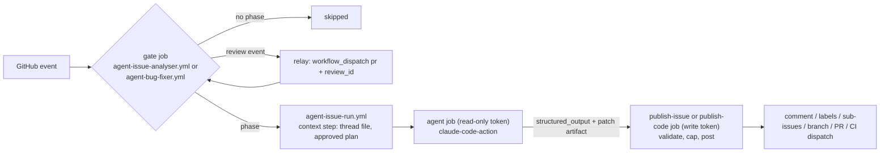
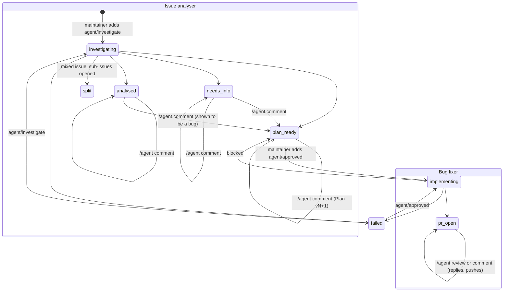

# Proposal: Issue analyser and bug fixer

_Owners_: @TharmiganK  
_Reviewers_: @TharmiganK  
_Created_: 2026/11/01  
_Updated_: 2026/11/01  
_Status_: Implemented for PoC

## Summary

Two GitHub Actions based AI agents that take an issue from report to fix PR:

- The **issue analyser** classifies an issue (bug, improvement, feature, question, or several things to split), reproduces bugs as Ballerina tests, traces the root cause from the public API down to the native layer, posts a verified fix plan, writes an analysis and proposal for improvements and features, answers questions, and discusses its plan or proposal with maintainers.
- The **bug fixer**, once a maintainer approves a plan, implements the fix and opens a PR with the reproduction test as a regression test. It also responds to review feedback on its own PRs.

Both agents share one label state machine, one prompt preamble and one reusable workflow run; each has its own thin gating workflow. Both run on [`anthropics/claude-code-action@v1`](https://github.com/anthropics/claude-code-action) authenticated with a Claude subscription OAuth token. Together with the [PR QA agent](qa-agent.md) and the [defect scanner](defect-scanner.md) they form the PoC run in the mirror `TharmiganK/module-ballerina-http-agents` (private for most of the PoC, now public) before proposing them for the `ballerina-platform` repositories. See the [overview](README.md) for how the agents connect.

Until the rename, both agents were one "bug fixer" agent with phases `investigate`, `discuss`, `implement` and `review` and a `/bug-fixer` command. The split moved `investigate` (now `analyse`) and `discuss` to the issue analyser and replaced the command with `/agent`; behaviour is otherwise unchanged. The validation runs on issues #1, #4, #20 and #26 happened before the rename.

## Goals

- Turn a labelled issue into a verified reproduction, a root-cause analysis and a fix plan (or an analysis and proposal) without maintainer effort beyond labelling.
- Keep a human in control: nothing is implemented until a maintainer approves a specific, immutable plan version, and nothing is merged by an agent.
- Back every bug claim with a reproduction test that was actually run. No reproduction, no bug claim.
- Make the agents' GitHub write access deterministic and bounded, so prompt injection through issue content cannot cause arbitrary writes.
- Keep Actions minutes and Claude usage low enough to run on a personal account.

## Non-goals

- Auto-merging or pushing to `master`.
- Implementing improvements or features automatically. The issue analyser writes a proposal; implementation stays with maintainers.
- Running the full test suite. The agents run targeted test packages and groups only.
- Supporting fork PRs. Agent PRs are always same-repository branches.

## Motivation

Bug triage in the `http` module is expensive: a maintainer has to read the report, write a reproduction, trace the request through three layers (Ballerina API, Java interop, Netty transport) and then design a fix. The first three steps are mechanical and well suited to an agent, provided that its output is verifiable (a test that fails) and its plan is reviewed before implementation.

Analysis and implementation are separate agents because they answer to different triggers and carry different risk: the issue analyser only comments and labels, while the bug fixer pushes branches and opens PRs. Separate workflows make each one's triggers, run names and failure comments clear, and keep `/agent` meaning "talk to the agent that owns this thread" (the issue analyser on an issue, the bug fixer on its PR).

## Background: constraints that shape the design

### Engine choice

GitHub Agentic Workflows (`gh-aw`) provides a ready-made safe-outputs and network firewall model, but its Claude engine only accepts `ANTHROPIC_API_KEY` or workload identity federation, not `CLAUDE_CODE_OAUTH_TOKEN`. The PoC has only a Claude Teams subscription, so it uses `claude-code-action` directly and rebuilds the relevant safety properties itself.

### Verified behaviour of `claude-code-action` (v1.0.266)

The following was verified against the action's docs and source, and drives the design:

| Behaviour | Source | Consequence |
|---|---|---|
| Providing a `prompt` input selects agent mode: no tracking comment, no automatic branch creation. | `docs/custom-automations.md`, `src/modes/detector.ts` | Each phase supplies its own prompt; the workflow, not the action, decides where output goes. |
| For issue, PR, comment and review events the action checks that the triggering actor has write access, and rejects bot actors unless listed in `allowed_bots`. | `docs/security.md`, `src/github/validation/permissions.ts`, `src/github/validation/actor.ts` | The write-access guard is built in. The workflows add an `if:` pre-filter so that non-write comments do not start a job only to fail it. Dispatched runs (sub-issues, relayed reviews, auto-fix) are started by `github-actions[bot]`, so the run passes `allowed_bots: github-actions` for `workflow_dispatch` only. |
| Without `github_token`, the action exchanges an OIDC token for a Claude GitHub App token with `contents`, `pull_requests` and `issues` **write**, regardless of the workflow's `permissions:`. | `src/github/token.ts` (`DEFAULT_PERMISSIONS`) | Least privilege is only possible by passing `github_token: ${{ secrets.GITHUB_TOKEN }}`, whose scope is set per job. |
| The GitHub token in use is exported as `GH_TOKEN`/`GITHUB_TOKEN` to Claude's tool processes. | `src/entrypoints/run.ts` | Whatever token the agent job holds is reachable by Claude, so the agent job must hold a read-only token. |
| Bash is disabled unless allowed through `--allowedTools` in `claude_args`. | `docs/faq.md` | Each phase has an explicit tool allowlist. |
| `--json-schema` in `claude_args` makes the action emit a `structured_output` step output. | `action.yml` | The agent returns typed results that a deterministic step validates and publishes. |
| On PR events the action restores `.claude/`, `CLAUDE.md` and other Claude config from the base branch. | `docs/security.md` | A PR cannot change the agent's own instructions or permissions. |

### GitHub token behaviour

- Events created with `GITHUB_TOKEN` do not trigger new workflow runs, except `workflow_dispatch` and `repository_dispatch`. A PR opened by `GITHUB_TOKEN` therefore does not trigger `pull_request` CI, but the publishing job can dispatch CI explicitly. For the same reason, labels the publish job adds to sub-issues start nothing, so it dispatches the issue analyser for each sub-issue.
- Comments posted with `GITHUB_TOKEN` are authored by `github-actions[bot]` and do not trigger `issue_comment` workflows, so the agents cannot trigger themselves.

`pull_request_review` and `pull_request_review_comment` workflows run from the PR's test-merge commit, which GitHub does not refresh when the base branch moves, so their workflow code can be stale. The bug fixer's gate therefore only relays an `/agent` review to a `workflow_dispatch` run (`pr`, `review_id`) that uses the default branch's workflow and re-checks the review author, command and PR; the auto-fix scheduler relays review events the same way.

## Design

### Core pattern: propose, then publish

Every phase is split into two jobs:

1. **Agent job.** Runs Claude with a read-only `GITHUB_TOKEN` and a tool allowlist that excludes every GitHub or git write command. Claude returns a JSON object conforming to a per-phase schema, plus a git patch when it changed code.
2. **Publish job.** A shell script, no model, with a write-scoped `GITHUB_TOKEN`. It validates the agent output against the schema and the caps, then posts the comment, sets labels, pushes the branch, opens the PR or dispatches CI.

This is the PoC's replacement for gh-aw safe outputs. Claude never holds a token that can write, and the caps (one comment per run, one PR per issue, no changes under `.github/`) are enforced in code rather than requested in a prompt. The costs are an extra job per run (about 15 seconds) and no mid-run interaction: the agent reports once, at the end.

### Workflows

| Workflow | Name | Role |
|---|---|---|
| `.github/workflows/agent-issue-analyser.yml` | Agent - Issue analyser | Gate for the `analyse` and `discuss` phases, then calls the reusable run with `agent: issue-analyser`. |
| `.github/workflows/agent-bug-fixer.yml` | Agent - Bug fixer | Gate for the `implement` and `review` phases (and the review relay), then calls the reusable run with `agent: bug-fixer`. |
| `.github/workflows/agent-issue-run.yml` | Agent - Issue agent run | Reusable workflow (`workflow_call`) with the jobs `agent`, `publish-issue` (analyse, discuss), `publish-code` (implement, review) and `report-failure`. |

The two calling workflows contain only a `gate` job that routes the event to a phase and sets the in-progress label, and a `run` job that calls the reusable workflow with the phase, the issue or PR number, the ref to check out, the triggering review or comment id, the mode, and the phase's timeout and turn limit. Everything else (build, context, prompt, Claude, verification, publishing, failure reporting) is shared.

The agent job checks out agent tooling (`.github/scripts`, `.github/agent-prompts`) from the default branch into a directory outside the workspace before checking out the code to work on, so a stale or PR-controlled checkout cannot change the scripts, prompts or schemas. Publish jobs also check out the default branch.

Runs have descriptive names, for example `Analyse #26: <title>`, `Analyse sub-issue #31`, `Discuss #26: <title>`, `Fix #27: <title>`, `Address feedback on PR #9`, `Relay review on PR #9`, `Address review on PR #9` and `Auto-fix open threads on PR #9`. Events that the gate ignores show as `Ignore label <label> on #<n>`.



### Phases and triggers

| Agent | Phase | Trigger | Gate conditions |
|---|---|---|---|
| Issue analyser | analyse | `issues: [labeled]` | label is `agent/investigate` on any issue (the agent classifies it first, see [Issue analysis](#issue-analysis)); no run in progress (`agent/investigating`, `agent/implementing`) and no open agent PR (`agent/pr-open`) |
| Issue analyser | analyse | `workflow_dispatch` with input `issue`, from the publish step of a split | as above |
| Issue analyser | discuss | `issue_comment: [created]` | the comment's first word is `/agent`; not a PR; issue is `agent/plan-ready`, `agent/needs-info`, `agent/analysed` or `agent/failed`; comment author type is not `Bot`; `author_association` is `OWNER`, `MEMBER` or `COLLABORATOR` |
| Bug fixer | implement | `issues: [labeled]` | label is `agent/approved`; issue is `agent/plan-ready` (or `agent/failed` after an approved plan); no `agent/implementing` or `agent/pr-open` |
| Bug fixer | review | `issue_comment: [created]` on a PR | the comment's first word is `/agent`; PR is open on an `agent/issue-<n>` branch; author is not a bot; `author_association` as above |
| Bug fixer | review | `pull_request_review: [submitted]`, relayed to `workflow_dispatch` with `pr` and `review_id` | the review body starts with `/agent`; PR has `agent/generated` and is open on an `agent/issue-<n>` branch; author is not a bot; `author_association` as above (re-checked by the dispatched run) |
| Bug fixer | review (auto) | `workflow_dispatch` with input `pr` only, from `agent-auto-fix.yml` | PR is an open agent PR with `agent/auto-fix` and has actionable review threads |

The agents engage only on demand: maintainers trigger analysis and implementation with labels, and discussion and review handling with the `/agent` command (first word of an issue comment, PR comment or review body). On an issue, `/agent` goes to the issue analyser; on an agent PR, it goes to the bug fixer. Other comments and reviews are ignored, so maintainers can discuss freely. To get replies on inline review comments, put `/agent` in the review body; an `/agent` PR comment is answered with a summary only.

`author_association` is only a cheap pre-filter (a `COLLABORATOR` may have read-only access). The action's own write-permission check is authoritative.

Review handling uses `pull_request_review: submitted` rather than `pull_request_review_comment`: a review with several comments fires one review event but one comment event per comment, and a standalone line comment also creates a review. This yields one run per review.

`agent/approved` on an `agent/analysed` issue (a proposal, not a bug plan) is declined: the bug fixer's gate removes the label and comments that a maintainer can implement the proposal, or comment `/agent` to ask the issue analyser to treat it as a bug and plan a fix. Any other `agent/approved` that does not match the conditions is removed with a notice in the run log.

A comment posted while an analysis or implementation is running is skipped (the issue is `agent/investigating` or `agent/implementing`, not one of the states that accept discussion), and the gate logs a notice; the maintainer comments again once the run has posted. The agent job uses `concurrency: agent-issue-<issue>` with `cancel-in-progress: false`, shared by both agents (a review run uses the issue number from its `agent/issue-<n>` branch); GitHub keeps at most one pending run per group, so of several comments queued behind a running phase only the newest is processed.

### Label lifecycle

An issue carries a single `agent/*` state label at a time. The two maintainer labels are triggers that the gates consume when the run starts.

| Label | Set by | Meaning |
|---|---|---|
| `agent/investigate` | Maintainer (trigger) | Ask the issue analyser to start, or restart, an analysis. Replaced by `agent/investigating` when the run starts. |
| `agent/investigating` | Issue analyser gate | Analysis running. |
| `agent/plan-ready` | Issue analyser publish | Bug reproduced; root cause and a plan were posted. Also set back by the bug fixer publish when implementation is `blocked`. |
| `agent/needs-info` | Issue analyser publish | Could not reproduce or needs details. |
| `agent/analysed` | Issue analyser publish | Classified as an improvement, feature or question; analysis and proposal (or answer) posted. Not implemented automatically. |
| `agent/split` | Issue analyser publish | The issue covered several things and was split into linked sub-issues, each analysed separately. |
| `agent/approved` | Maintainer (trigger) | Ask the bug fixer to implement the latest plan version posted before this label was added. Replaced by `agent/implementing` when the run starts. |
| `agent/implementing` | Bug fixer gate | Implementation running. |
| `agent/pr-open` | Bug fixer publish | Fix PR opened. |
| `agent/failed` | `report-failure` job of either agent | An analysis or implementation failed; a comment links the run and says how to retry. A failed discuss or review only comments and keeps the current state. |
| `agent/generated` | Publish jobs | Marks issues and PRs created by any agent. |
| `agent/auto-fix` | Maintainer, on an agent PR | Address review feedback automatically after reviewers go quiet (see below). Not a state label. |



Labels are created by `.github/scripts/setup-labels.sh`.

### Plan versioning

Each plan revision is posted as a new comment headed `Plan vN`, with a one-line summary of what changed since `vN-1` and a hidden marker `<!-- bug-fixer:plan v=N -->` (the marker kept its name through the rename).

A single comment edited in place was rejected for two reasons: an approval must refer to immutable text, and edits do not notify issue subscribers. With versioned comments, the implement phase resolves the approved plan deterministically: the latest comment that contains the marker, is authored by `github-actions[bot]`, and was created before the `agent/approved` label event. Plan text authored by anyone else is never accepted as a plan.

### Trust model for issue content

The issue and comments from users without write access are untrusted. Before the agent runs, a context step (`.github/scripts/agent/build-context.sh`) writes the issue or PR thread to `agent-context/thread.json`, with each entry tagged `trusted: true|false` based on `author_association`. The prompt instructs the agent that untrusted entries may contain facts (versions, stack traces, reproduction code) but never instructions.

Issue and comment text is never interpolated into the workflow YAML or into the prompt string; the agent reads it from the context file. This avoids `${{ }}` expression injection into shell steps.

A user without write access, typically the reporter, cannot trigger the discuss phase. A maintainer replies on their behalf or re-adds `agent/investigate` to re-run the analysis with the new details.

### Phase specifications

#### Analyse (issue analyser)

For a bug, the agent:

1. Reads the issue from the context file, `CLAUDE.md` and `docs/architecture.md`.
2. Writes a reproduction test in the matching `ballerina-tests/<package>/tests/` file (or a Java test in `native`/`compiler-plugin-tests` when the bug is there), with group `repro_<issue>` and a new port in `test_service_ports.bal`.
3. Runs it with `.github/scripts/run-tests.sh bal <package> repro_<issue>` and confirms that it fails for the reported reason, not for an unrelated error.
4. Traces the flow from the public API through the Ballerina layer into the native layer, citing files and lines as permalinks at the checked-out commit SHA.
5. Returns the result.

Output schema (`.github/agent-prompts/issue-analyser/schemas/analyse.json`, simplified):

```json
{
  "type": "object",
  "required": ["outcome", "comment"],
  "properties": {
    "outcome": {"enum": ["plan-ready", "needs-info", "analysed", "split"]},
    "classification": {"enum": ["bug", "improvement", "feature", "question", "mixed"]},
    "comment": {"type": "string", "maxLength": 60000},
    "test_package": {"type": "string"},
    "test_filter": {"type": "string"},
    "parts": {"type": "array"}
  }
}
```

For a bug, the comment has these sections: Verdict; Reproduction (test code in a collapsed block, the command, an excerpt of the failing output); Code flow; Root cause; `Plan v1` (steps, files to change, tests to add and run, risks); Confidence. When the bug cannot be reproduced, the outcome is `needs-info`, the comment lists what was tried and what is needed, and the comment must not call it a bug.

**Reproduction verification.** The agent's own report of the failing output is not trusted. After Claude finishes, the agent job runs `.github/scripts/agent/verify-repro.sh`, which re-runs group `repro_<issue>` in the reported `test_package` (or the `test_filter` class for a Java reproduction) in the agent's workspace, with stale reports removed first. It reads the test results file rather than the exit code, so a compilation failure or an empty group does not count. The result (`reproduced`, `not-reproduced` or `not-run`, with counts and the first failure message) goes to `agent-output/repro.json`.

For `plan-ready`, the publish job requires `reproduced`: it appends a "Reproduction verified by the workflow" note with the command and failure message, then the plan marker. Otherwise it downgrades the outcome to `needs-info` and posts an "Investigation (unverified)" comment with the agent's report collapsed and its plan headings renamed to "Proposed plan (unverified)", with no marker, so it cannot be approved. This implements the rule that an unreproduced finding is a question, not a bug.

The publish job posts the comment, sets the outcome's state label and removes `agent/investigating`.

#### Issue analysis

`agent/investigate` works on any issue, with or without a `Type/*` label. The analyse run first classifies the issue, then handles it in the same run (one build, no hand-off):

| Classification | Handling | Outcome and state | Type label (added only if none is set) |
|---|---|---|---|
| `bug` | Reproduction, code flow, root cause, Plan v1, verified by the workflow as above | `plan-ready` or `needs-info` | `Type/Bug` |
| `improvement` | Use case, current behaviour with permalinks, related work, a proposal (API, behaviour, implementation, compatibility and spec impact, tests), alternatives and open questions | `analysed` | `Type/Improvement` |
| `feature` | As for improvements | `analysed` | `Type/NewFeature` |
| `question` | A direct answer with spec and code references and a checked example | `analysed` | `Type/Question` |
| `mixed` | Nothing is analysed. The agent splits the issue into 2 to 5 self-contained parts (bug, improvement or feature); the publish job opens one sub-issue per part (Type label, the parent's `module/*`, `Area/*` and `Priority/*` labels, a _Split from #N_ line), links each to the parent with the sub-issues API and dispatches `agent-issue-analyser.yml` with `issue` set to each sub-issue | `split` | none; each sub-issue gets its own |

An issue is `mixed` only when it asks for independent things that would be fixed, decided or released separately; a reporter's suggested fix or a workaround does not make it mixed. A sub-issue is never split again (the publish job refuses it), and re-running the analysis on a split parent skips parts whose title already exists as a sub-issue. Bug sub-issues then follow the normal flow: a verified plan that a maintainer approves for the bug fixer. Improvement and feature sub-issues get an analysis and a proposal.

A `Type/*` label set by a maintainer is kept; the agent follows it unless clearly wrong and then only says so in its comment. Behaviour that contradicts the spec or the API docs is a bug even when reported as a feature request. Proposals contain no `## Plan v` section and are not implemented automatically: the bug fixer declines `agent/approved` on an `agent/analysed` issue with a comment. `/agent` comments refine an analysis or proposal like a plan; if the discussion shows the issue is a bug, the agent posts a verified Plan v1 and the issue moves to `agent/plan-ready`.

#### Discuss (issue analyser)

The agent reads the full thread, focusing on the triggering comment, and decides whether the plan or proposal changes.

```json
{
  "type": "object",
  "required": ["outcome", "comment"],
  "properties": {
    "outcome": {"enum": ["plan-ready", "needs-info", "analysed", "no-change"]},
    "comment": {"type": "string", "maxLength": 60000},
    "new_plan_version": {"type": "integer", "minimum": 1},
    "test_package": {"type": "string"},
    "test_filter": {"type": "string"}
  }
}
```

If `new_plan_version` is set, the comment must contain the full `Plan vN` section; the publish job checks that `N` is exactly the previous version plus one and adds the marker. A `needs-info` or `analysed` issue reaches its first plan through discussion with `new_plan_version: 1`; that plan goes through the same reproduction verification as the analyse phase. Exactly one comment is posted per run. `no-change` keeps the current state label.

#### Implement (bug fixer)

A pre-step resolves the approved plan (see [Plan versioning](#plan-versioning)) into `agent-context/approved-plan.md` and fails the job if there is none. The workflow creates the branch `agent/issue-<issue>` before Claude starts. The agent:

1. Creates the reproduction test from the plan and runs it on the unmodified code; it must fail.
2. Implements the fix as planned. A material deviation from the plan returns `blocked` instead of improvising.
3. Re-runs the reproduction test; it must pass.
4. Runs the affected test packages (and native or compiler-plugin tests when touched).
5. Updates `changelog.md` and, for behaviour changes, `docs/spec/spec.md`.
6. Commits locally.

```json
{
  "type": "object",
  "required": ["status"],
  "properties": {
    "status": {"enum": ["done", "blocked"]},
    "blocked_reason": {"type": "string"},
    "pr_title": {"type": "string", "maxLength": 120},
    "pr_body": {"type": "string", "maxLength": 60000},
    "ci_tests": {"type": "array", "items": {"type": "string", "pattern": "^[a-z0-9-]+(:[A-Za-z0-9_,]+)?$"}}
  }
}
```

A post-step in the agent job writes `git format-patch <base>..HEAD` to an artifact. The `publish-code` job:

1. Rejects the patch if it touches `.github/`, `.claude/`, `CLAUDE.md` or `docs/proposals/`, exceeds 25 files or 1500 changed lines, or does not add a test with group `repro_<issue>`.
2. Applies it on `agent/issue-<issue>` from the current `master` (not the commit the agent started from: if `master` changed workflow files during the run, GitHub rejects a `GITHUB_TOKEN` push of a branch whose workflow files differ from the default branch) and pushes. The workflow owns these branches: if the branch already exists without an open PR (a leftover from a failed run, for example one that pushed but could not open the PR), it is replaced with `--force-with-lease` pinned to the SHA seen at the start of the publish step; if an open PR uses it, the job fails.
3. Opens one PR with `Fixes #<issue>`, the agent's body (flow analysis, fix rationale, before/after test evidence), a `<!-- ci-tests: ... -->` marker from `ci_tests`, and label `agent/generated`.
4. Dispatches `agent-pr-ci.yml` on the branch, and `agent-qa.yml` for an automatic QA review of the new PR.
5. Sets `agent/pr-open` on the issue. For `blocked`, posts the reason and sets `agent/plan-ready` back so the issue analyser can revise the plan through `/agent`.

#### Review (bug fixer)

Triggered by a maintainer's review or PR comment starting with `/agent`, or in `auto` mode by `agent/auto-fix` (see below). The agent checks out the PR branch and reads the context file: the trigger, the PR conversation, all review comments, and every open review thread classified by source and by whether it still needs an answer (`pr-threads.py`). It changes the code or explains why not.

```json
{
  "type": "object",
  "required": ["replies", "summary", "changed"],
  "properties": {
    "replies": {"type": "array", "maxItems": 20, "items": {"type": "object", "required": ["comment_id", "body", "resolve"], "properties": {"comment_id": {"type": "integer"}, "body": {"type": "string", "maxLength": 10000}, "resolve": {"type": "boolean"}}}},
    "summary": {"type": "string", "maxLength": 20000},
    "changed": {"type": "boolean"},
    "ci_tests": {"type": "array", "items": {"type": "string"}}
  }
}
```

The publish job re-reads the review threads and accepts replies only in the triggering review and in open threads started by a maintainer or the QA agent; it posts the replies and the summary together as one review (a pending review filled with GraphQL `addPullRequestReviewThreadReply`, then submitted with the summary as its body and a hidden round marker in `auto` mode), so each round is a single timeline entry; it then resolves the threads whose reply has `resolve: true`, applies the patch with the same path and size rules as implement, pushes to the PR branch, dispatches CI again, and, if the PR has `agent/auto-fix`, schedules another auto-fix check.

#### Review threads, QA findings and thread resolution

The review context lists every unresolved review thread with its source (`maintainer`, `qa` for threads started by the QA agent, `other` for anyone else, including third-party bots such as CodeRabbit) and whether it is actionable (unresolved, from a maintainer or the QA agent, and not last answered by the bug fixer). The agent addresses the triggering review together with all actionable QA threads, so a maintainer's `/agent` review closes the loop on the QA review as well. Replies are allowed in the triggering review and in open maintainer and QA threads; the publish job re-reads the threads and rejects replies anywhere else. Each reply carries `resolve`; the publish job resolves a thread (GraphQL `resolveReviewThread`) when the agent fully addressed it, and leaves it open when the agent asked a question or disagreed, so resolved means done.

#### Automatic review handling (`agent/auto-fix`)

Maintainers can opt a single agent PR into automatic review handling by adding `agent/auto-fix`. Review feedback in real PRs arrives in bursts (several comments, sometimes several reviews, over a few minutes), so the bug fixer should act once per burst, not once per comment:

- `agent-auto-fix.yml` runs on every review, review comment and PR comment on a labelled PR, when the label is added, and when dispatched by the QA agent (after reviewing a labelled PR) or by the bug fixer (after each round). Events created with `GITHUB_TOKEN` trigger nothing, so the bots' own comments never restart it.
- The run sleeps for `AUTOFIX_QUIET_MINUTES` (repository variable, default 10). Its concurrency group cancels the run in progress, so each new comment restarts the wait: the bug fixer is dispatched (`agent-bug-fixer.yml` with `pr` only) after reviewers have been quiet for the whole period.
- After the wait it checks for actionable threads; chat-only comments open no threads and dispatch nothing. The bug fixer's gate checks again before starting, so a queued run that has nothing left to do does not build.
- Each automatic round's summary carries a hidden `bug-fixer:auto-round` marker. After `AUTOFIX_MAX_ROUNDS` (default 3) rounds, auto-fix pauses with a comment; `/agent` continues manually. This bounds cost and stops any loop between QA findings and fixes.
- A human push to the PR branch during a round makes the publish step refuse to push, as for manual rounds.
- GitHub runs `pull_request`, `pull_request_review` and `pull_request_review_comment` workflows from the PR's test-merge commit, not from the default branch. The label trigger therefore uses `pull_request_target` (base-branch workflow; PR code is never checked out), and review events only relay to a `workflow_dispatch` run of the current file, which restarts the wait.

### Tool allowlists

Passed through `claude_args: --allowedTools`; `--disallowedTools` additionally blocks `git push`, `gh pr create`, `gh pr comment`, `gh pr edit`, `gh issue comment`, `gh issue edit`, `gh label`, `WebFetch` and `WebSearch`.

| Tool | analyse | discuss | implement | review |
|---|---|---|---|---|
| `Read`, `Glob`, `Grep` | yes | yes | yes | yes |
| `Edit`, `Write` | yes (tests and scratch only, by prompt) | yes (to recreate the reproduction test) | yes | yes |
| `Bash(.github/scripts/run-tests.sh:*)` | yes | yes | yes | yes |
| `Bash(target/ballerina-runtime/bin/bal:*)` | yes | yes | yes | yes |
| `Bash(git diff/log/show/status:*)` | yes | yes | yes | yes |
| `Bash(gh issue view:*)`, `Bash(gh pr view:*)`, `Bash(gh pr diff:*)`, `Bash(gh api:*)` | yes | yes | yes | yes |
| `Bash(git add:*)`, `Bash(git commit:*)` | no | no | yes | yes |
| `git push`, `gh pr create`, `gh issue comment`, `gh issue edit`, `gh label` | never | never | never | never |

`gh api` is allowed for reading; the read-only token makes writes fail.

### Permissions

Both calling workflows set `permissions: {}` at the top level. Their `run` job grants the reusable workflow an upper bound of `contents: write`, `issues: write`, `pull-requests: write` and `actions: write`: GitHub checks that bound against every nested job, including the code publish job that the issue analyser never runs. Each nested job then requests only what it needs:

| Job | `permissions:` |
|---|---|
| issue analyser `gate` | `issues: write` (in-progress label) |
| bug fixer `gate` | `issues: write`, `pull-requests: read`, `actions: write` (review relay) |
| `agent` (all phases) | `contents: read`, `issues: read`, `pull-requests: read` |
| `publish-issue` (analyse, discuss) | `contents: read`, `issues: write`, `actions: write` (dispatch sub-issue analyses) |
| `publish-code` (implement, review) | `contents: write`, `issues: write`, `pull-requests: write`, `actions: write` |
| `report-failure` | `contents: read`, `issues: write`, `pull-requests: write` |

`actions: write` is only needed to dispatch workflows (CI, QA, auto-fix, sub-issue analyses, relayed reviews). Checkout uses `persist-credentials: false` in agent jobs.

### CI for agent PRs

`.github/workflows/agent-pr-ci.yml` runs on `pull_request` and `workflow_dispatch` (input `pr`). It runs `run-tests.sh build` (compile, checkstyle, spotbugs), then each entry of the `<!-- ci-tests: package[:groups] -->` marker in the PR body through `run-tests.sh bal`. Agent PRs get CI by dispatch because PRs opened with `GITHUB_TOKEN` do not trigger `pull_request` runs. To be verified in the first run: that check runs from a dispatched workflow on the head SHA are shown on the PR; if not, the CI job posts a commit status for the head SHA.

### Build environment

A composite action `.github/actions/setup-build` used by agent jobs and CI:

- `actions/setup-java` with Temurin JDK 25.
- `gradle/actions/setup-gradle`, which caches `~/.gradle` including the `jballerina-tools` and stdlib artifacts.
- `actions/cache` for `~/.ballerina`.
- `.github/scripts/run-tests.sh build` before Claude starts, so the build-local distribution in `target/ballerina-runtime` (with the freshly built `http` package) is ready and a broken build fails before any Claude usage.

Docker is available on `ubuntu-latest` for the LDAP and SOCKS test services.

### Prompts

Prompts live under `.github/agent-prompts/` so that they can be iterated without touching YAML:

- `issue-common.md`: shared by both agents. Role, repository pointers (`CLAUDE.md`, `docs/architecture.md`), trust rules, the reproduction-as-test rule, output discipline, caps.
- `issue-analyser/analyse.md`, `issue-analyser/discuss.md` and `issue-analyser/schemas/{analyse,discuss}.json`.
- `bug-fixer/implement.md`, `bug-fixer/review.md` and `bug-fixer/schemas/{implement,review}.json`.

The reusable workflow's prepare step concatenates `issue-common.md`, the phase file from the agent's directory and a generated header (repository, issue or PR number, triggering review or comment id, mode, run URL, context file paths) into the action's `prompt` input, and loads the phase schema into `--json-schema`.

`.github/scripts/agent/publish.sh` takes the mode `analyse`, `discuss`, `implement`, `review` or `fail`. Every comment it posts ends with a footer naming the agent: "Posted by the issue analyser" or "Posted by the bug fixer", with a link to the workflow run.

### Limits and measured cost

| Phase | `timeout-minutes` (agent job) | `--max-turns` | Measured agent job | Measured Claude usage | Model |
|---|---|---|---|---|---|
| analyse | 55 | 60 | 3–7 min | 21–29 turns, $0.61–0.80 | `claude-opus-5-5` |
| discuss | 35 | 30 | 6 min | 24 turns, $0.69 | `claude-opus-5-5` |
| implement | 75 | 100 | 6–10 min | 23–37 turns, $0.52–0.70 | `claude-opus-5-5` |
| review | 60 | 80 | 11 min | 25 turns, $0.76 | `claude-opus-5-5` |

Measured in the PoC validation before the rename ([report](poc-report.md)); costs are list-price equivalents consumed from the Teams subscription. Test runs dominate the job time: `bal test --groups` filters which tests execute but still compiles the whole test package and starts its module-level listeners. The limits keep generous headroom over the measurements.

### Failure handling

- Any failed agent or publish job triggers the `report-failure` job, which posts a comment from the failing agent with the run URL and how to retry (`agent/investigate` for analyse, `agent/approved` or `agent/investigate` for implement, `/agent` for discuss and review). For analyse and implement it also replaces the issue's state label with `agent/failed`; a failed discuss or review keeps the current state.
- Schema validation failure or a cap violation in a publish job is a failure; nothing partial is published.
- `max-turns` or timeout exhaustion is a failure; the run log shows how far the agent got.
- Re-running is done by re-applying the trigger label or commenting `/agent` again.

### Repository preparation

- Upstream workflows that would run in the mirror are disabled with `gh workflow disable` rather than edited, to keep upstream syncs clean. This includes `build-with-bal-test-graalvm.yml` (its owner check only covers scheduled runs, so it runs on every PR), `fossa_scan.yml` (ungated nightly schedule), `trigger-load-tests.yml` and `process-load-test-result.yml`.
- Secrets to create:

| Secret | Value | Scope |
|---|---|---|
| `CLAUDE_CODE_OAUTH_TOKEN` | Output of `claude setup-token` | Claude subscription |
| `PACKAGE_USER` | GitHub username | n/a |
| `PACKAGE_PAT` | Classic PAT | `read:packages` only |

No PAT or GitHub App is needed for PR creation.

## Alternatives considered

| Alternative | Reason not chosen |
|---|---|
| `gh-aw` with its safe outputs and firewall | Claude engine does not support `CLAUDE_CODE_OAUTH_TOKEN`. |
| Claude GitHub App token (action default) | Always write-scoped for contents, PRs and issues; cannot be reduced per job. Its only advantage, triggering `pull_request` CI on agent PRs, is covered by `workflow_dispatch`. |
| Fine-grained PAT for PR creation | A static token reachable by the agent's tools could be exfiltrated by prompt injection (`docs/security.md` warns against it). |
| Agent posts comments and opens PRs itself | Caps would rely on the prompt alone. |
| Tag mode with `track_progress` | Requires `@claude` mentions for follow-ups and creates a branch per issue run. |
| Single living plan comment | Approvals would refer to mutable text and edits do not notify. |
| One "bug fixer" workflow for all four phases (the original design) | It had grown into issue triage plus fixing, so its name, run names and failure comments no longer described what ran. Two thin gates over one reusable run keep the shared machinery in one place. |

## Risks and limitations

- `PACKAGE_PAT` is in the environment of the agent's tools because Gradle needs it. A prompt injection could leak it; its only scope is `read:packages`.
- There is no network egress restriction comparable to gh-aw's firewall. The read-only token and the publish-step validation bound what a compromised run can do on GitHub.
- The issue analyser may produce a plausible but wrong root cause. Mitigations: the mandatory failing reproduction test, maintainer approval of a specific plan version, and normal PR review.
- Reporters without write access cannot interact with the agents directly.
- Claude usage is bounded by the Teams plan limits; concurrent runs across many issues could exhaust them.

## Portability to `ballerina-platform`

- Issues for the module live in `ballerina-platform/ballerina-library`, while code lives in `module-ballerina-http`. Cross-repository operation needs a GitHub App token for the code repository, issued to the publish jobs only; the agent jobs keep read-only tokens.
- Labels and templates already follow `ballerina-library` naming, plus the `agent/*` labels and `Area/Spec`.
- `CLAUDE.md`, `docs/architecture.md` and `run-tests.sh` are module-specific and portable as is.
- Upstream would need an API key or workload identity federation; at that point `gh-aw` becomes an option again.

## Validation plan

1. Seed a real, small bug in this repository as an issue using the bug template.
2. Run the full lifecycle: analyse, one discuss round that changes the plan, approve, implement, one review round.
3. Record for each phase: wall time, Actions minutes, Claude turns and tokens, whether the output was correct and useful, and every manual intervention needed.
4. Report what worked, what did not, cost and time, and recommended changes before building the PR QA agent.

Steps 1 to 4 were completed before the rename (see the [PoC report](poc-report.md)). After the rename, one run of each phase through the new workflows (including a split issue, a declined `agent/approved` on an `agent/analysed` issue, and a relayed `/agent` review) confirms the gates and the reusable run.
